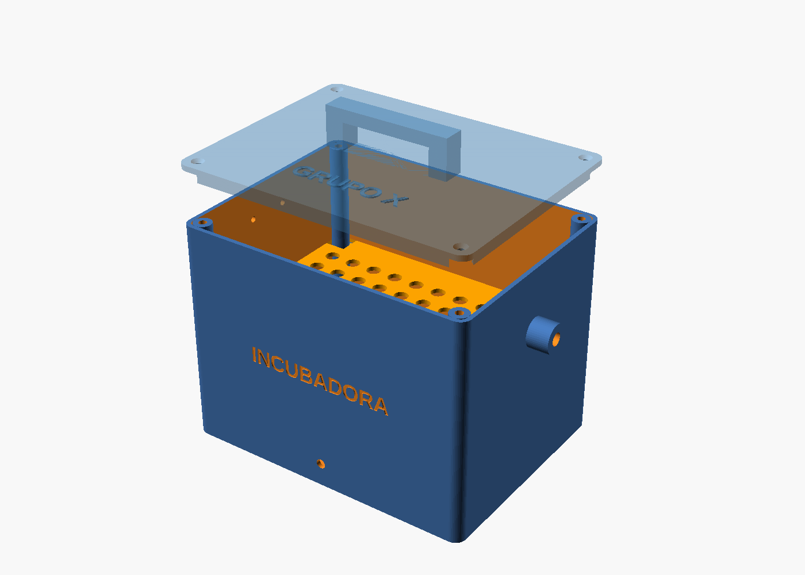
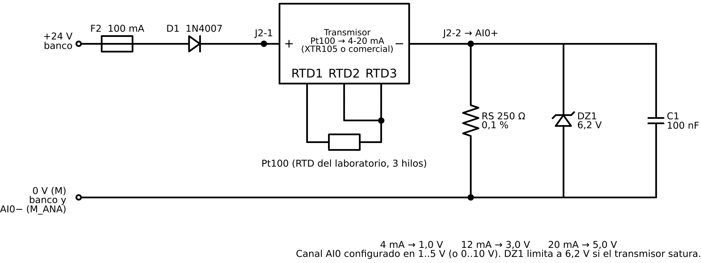
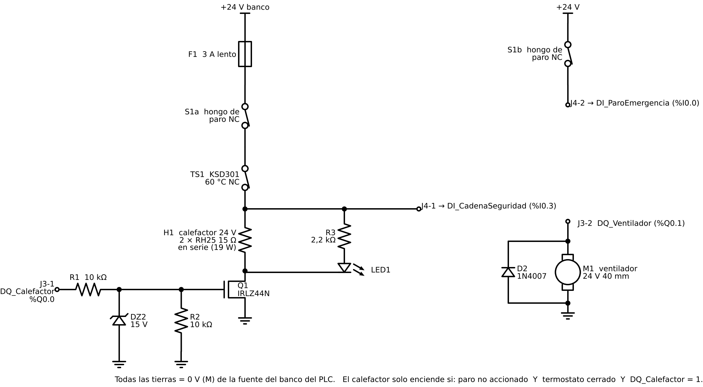

# 2. Hardware: planta, tarjeta de borneras y conexión

> Lo que está aquí se **construye y se cablea en el laboratorio**. Los archivos (carcasa STL,
> esquemáticos) están listos; la impresión, el montaje, la soldadura y la calibración los hace el grupo.

## 2.1 Carcasa (cerramiento impreso)

* Fuente paramétrica: [`hardware/carcasa/incubadora.scad`](../hardware/carcasa/incubadora.scad) (OpenSCAD).
  STL listos: `base.stl`, `tapa.stl`, `bandeja.stl`, `soporte_ventilador.stl`.
* Cámara interior 160 × 120 × 120 mm, pared 2,4 mm. Cambie `grupo = "GRUPO X"` por el nombre del grupo.
* **Material: PETG, ASA o ABS. No use PLA**: su transición vítrea está entre 55 y 60 °C y la cámara
  trabaja a 43–55 °C (con el calefactor a más temperatura).
* Impresión: capa 0,24 mm, 4 perímetros, 25 % de relleno giroide, sin soportes. Unos 350 g de filamento.
* Montaje:
  * Placa de aluminio de 100 × 80 × 3 mm con las 2 resistencias RH25, sobre **separadores de latón M3 × 15**
    (la placa caliente no debe apoyarse en el plástico).
  * RTD por el manguito lateral, a la altura de la bandeja (mide el aire del producto, no la placa).
  * KSD301 atornillado arriba, en la pared izquierda. Ventilador de 40 mm en su escuadra, soplando sobre la placa.
  * Cables por un prensaestopas PG9. Burlete de espuma en el borde de la tapa. 4 insertos roscados M3 en las torres.

## 2.2 Calefactor y balance térmico

| Dato | Valor | De dónde sale |
|---|---|---|
| Calefactor | 2 × RH25 15 Ω en serie = 30 Ω → 24² / 30 = **19,2 W**, 0,8 A | Cabe en la fuente de 24 V del banco |
| Área exterior | ≈ 0,11 m² | Geometría de la carcasa |
| U global | ≈ 3,5 W/m²K (convección interior con ventilador + PETG + convección exterior) | Estimado |
| R térmica | 1 / (U·A) ≈ **2,4 K/W** | → T máx. teórica ≈ 19 + 19,2 × 2,4 ≈ 65 °C |
| C térmica | ≈ 450 J/K (aire + paredes + bandeja) | Estimado |
| τ = R·C | ≈ 18 min | Llega a 43 °C en unos 15 min (ver la simulación) |

Como la temperatura máxima teórica (~65 °C) supera la consigna máxima, hay **tres protecciones**:
`SP_Max` = 55 °C en el PLC, la alarma HH a 60 °C que apaga el calefactor, y el KSD301 de 60 °C cableado
en serie con la potencia (funciona aunque el PLC falle).

**Identificación del modelo (hágala en el laboratorio):** con la cámara a temperatura ambiente, active el
calefactor al 100 % (Modo manual: fuerce `DQ_Calefactor`) durante 20 min y registre la temperatura con el
gateway. Ajuste un primer orden con tiempo muerto `K·e^(−θs)/(τs+1)`: K = ΔT∞/P, τ = tiempo al 63 %,
θ = retardo inicial. Ponga esos valores en `DB_Param.Sim` y en el informe compare el modelo con lo medido.

## 2.3 Acondicionamiento de la RTD (lazo 4-20 mA)

La guía advierte que las entradas analógicas soportan **como máximo 10 V**. Una Pt100 no entrega voltaje;
hay que excitarla y amplificar. Se usa un **lazo de corriente 4-20 mA de 2 hilos**, el estándar industrial,
porque es inmune al ruido y a la caída en el cable, y porque la falla se detecta (corriente < 3,6 mA = lazo abierto).

* **R de carga de 250 Ω (0,1 %)**: 4 mA → 1 V, 20 mA → 5 V. Nunca pasa de 10 V. Aunque el transmisor
  sature (~25 mA = 6,25 V), el zener de 6,2 V limita.
* Configure el canal en TIA Portal como **"Tensión 1..5 V"** (`AI_Vmin = 1`, `AI_Vmax = 5`). Si su módulo
  no tiene ese rango, use "0..10 V" y cambie `AI_Vmax = 10`, `AI_Vmin = 0`.
* Rango 0–100 °C ↔ 4–20 mA (`T_Min = 0`, `T_Max = 100` en `DB_Param.Escalado`).

**Opción A, diseño propio con el XTR105** (transmisor 4-20 mA de 2 hilos para RTD, con linealización).
Cálculo para una Pt100 de 0 a 100 °C (Callendar–Van Dusen, A = 3,9083·10⁻³, B = −5,775·10⁻⁷):

| Magnitud | Valor |
|---|---|
| R_Z = R(0 °C) | 100,00 Ω (0,1 %) |
| R₁ = R(50 °C) | 119,40 Ω |
| R₂ = R(100 °C) | 138,51 Ω |
| R_G = [2R₁(R₂+R_Z) − 4R₂R_Z] / (R₂ − R₁) | **81,2 Ω** (use 80,6 Ω + trimmer de 5 Ω) |
| R_LIN = R_LIN1(R₂ − R₁) / [2(2R₁ − R₂ − R_Z)], con R_LIN1 = 1 kΩ | **33,1 kΩ** (33,2 kΩ E96) |

Verifique estos valores con la tabla 1 de la hoja de datos del XTR105 (TI, SBOS061) y arme el circuito
como en su figura de conexión de RTD de 3 hilos con linealización (incluye el transistor externo y R_CM).

**Opción B, transmisor comercial** "PT100 a 4-20 mA de 2 hilos" (tipo cabezal o de riel, 0–100 °C): es
más rápida y fiable; la tarjeta sigue llevando la R de carga, la protección y las borneras.

**Calibración:** con una década de resistencias en lugar de la Pt100: 100,00 Ω → 4,00 mA (1,000 V);
119,40 Ω → 12,00 mA; 138,51 Ω → 20,00 mA. Anote el error en °C (ver la tabla de pruebas, sección 8).

## 2.4 Potencia del calefactor, cadena de seguridad y ventilador

* El calefactor solo recibe 24 V si el **hongo no está accionado** y el **termostato está cerrado**
  (contactos en serie con la potencia: la seguridad no depende del software). El nodo después de ambos
  va a `DI_CadenaSeguridad` para que el PLC sepa si la cadena se abrió.
* Lado bajo con MOSFET de nivel lógico IRLZ44N. La salida del PLC (24 V) pasa por un divisor
  10 k / 10 k → 12 V en la compuerta (el máximo del IRLZ44N es ±16 V; el zener de 15 V protege).
  Con 0,8 A y R_DS(on) ≈ 25 mΩ disipa unos 16 mW: no necesita disipador.
* Segundo contacto NC del hongo → `DI_ParoEmergencia`.
* Ventilador de 24 V y 0,1 A directo desde `DQ_Ventilador`, con diodo de rueda libre.
* **Use las fuentes del banco, no fuentes reguladas** (lo exige la guía). Todas las tierras van al 0 V (M) del banco.

## 2.5 Tarjeta de borneras (PCB)

| Bornera | Pin | Señal | Va a |
|---|---|---|---|
| J1 | 1 / 2 | +24 V / 0 V | Fuente del banco del PLC |
| J2 | 1 / 2 | +lazo / salida del lazo | Transmisor (+ / −) |
| J2 | 3 / 4 | AI0+ / AI0− | Canal analógico del PLC |
| J3 | 1 | DQ_Calefactor | %Q0.0 |
| J3 | 2 | DQ_Ventilador | %Q0.1 |
| J4 | 1 | Cadena de seguridad | %I0.3 |
| J4 | 2 | Paro de emergencia (NC) | %I0.0 |
| J5 | 1 / 2 | Calefactor + / − | Resistencias RH25 |
| J5 | 3 / 4 | Termostato KSD301 | Termostato |
| J5 | 5 / 6 | Hongo S1a | Contacto NC de potencia |
| J6 | 1 / 2 | Ventilador + / − | Ventilador |
| J7 | 1 / 2 / 3 | RTD (3 hilos) | Si el transmisor va en la tarjeta |

Recomendaciones de ruteo: pistas de potencia de ≥ 2 mm (0,8 A), plano de 0 V, la R de 250 Ω y el lazo
lejos de las pistas del calefactor, bornera de tornillo de paso 5,08 mm y orificios de fijación M3.
Puede hacerla en KiCad partiendo de estos esquemáticos.

## 2.6 Lista de materiales

| Cant. | Elemento | Nota |
|---|---|---|
| 1 | Carcasa impresa (base, tapa, bandeja, soporte) | PETG ~350 g |
| 2 | Resistencia de potencia RH25 15 Ω 25 W | Calefactor (19,2 W en serie) |
| 1 | Placa de aluminio 100 × 80 × 3 mm + 4 separadores latón M3 × 15 | Disipa y reparte el calor |
| 1 | Termostato KSD301 60 °C NC | Protección cableada |
| 1 | Ventilador 24 V 40 × 40 mm | Recirculación |
| 1 | Hongo de paro 22 mm con 2 contactos NC | HS-101 |
| 1 | Pt100 del laboratorio | TT-101 |
| 1 | XTR105 + pasivos (opción A) o transmisor PT100 4-20 mA (opción B) | |
| 1 | Resistencia 250 Ω 0,1 % 0,25 W | Carga del lazo |
| 1 | Zener 6,2 V 0,5 W, zener 15 V 0,5 W | Protecciones |
| 1 | MOSFET IRLZ44N | Calefactor |
| 2 | 1N4007 | Polaridad del lazo, rueda libre |
| 3 | Resistencias 10 kΩ, 10 kΩ, 2,2 kΩ ¼ W | Compuerta y LED |
| 1 | LED rojo 5 mm | Calefactor encendido (ventana frontal) |
| 2 | Portafusible + fusibles 3 A lento y 100 mA | |
| 6 | Borneras de tornillo de 2 y 3 vías | J1–J7 |
| — | Cable AWG 18 (potencia) y AWG 22 apantallado (lazo) | |
