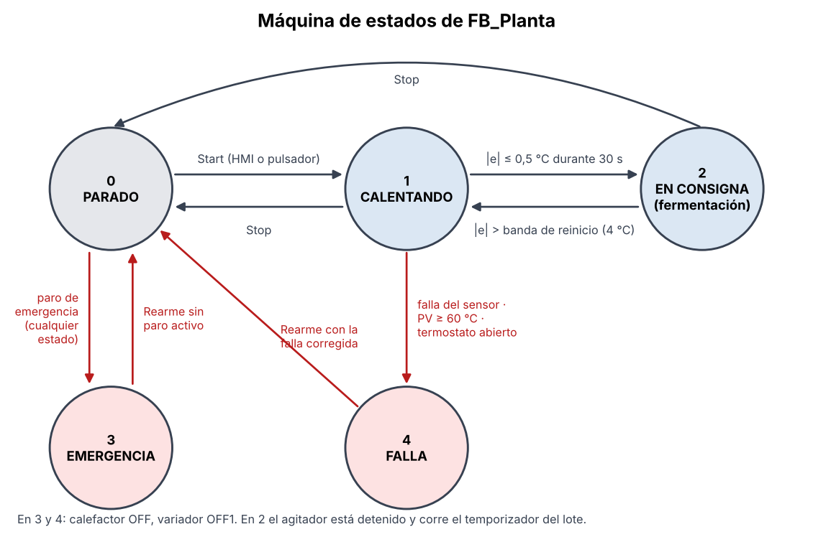
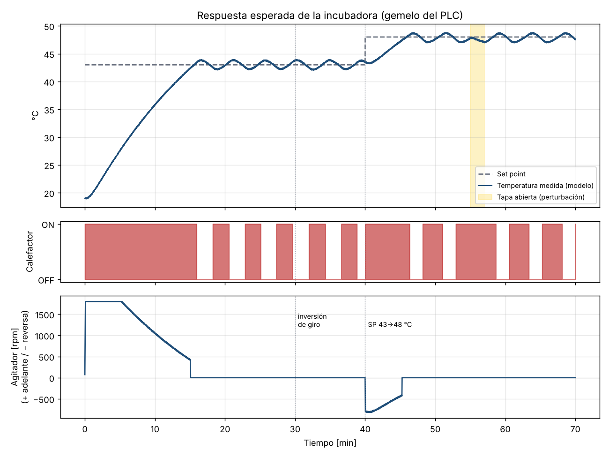

# 3. Programa del PLC (TIA Portal, S7-1500)

El grupo puede elegir el lenguaje de programación (sección 11 de la guía). Aquí se usó **SCL**: el algoritmo
se lee de corrido, se versiona como texto y se importa como fuente externa.

## 3.1 Archivos

| Archivo | Contenido |
|---|---|
| `plc/tablas/Variables_PLC.xlsx` | Tabla de variables (E/S físicas y telegrama del variador) para importar |
| `plc/fuentes_scl/01_DB_Globales.db` | `DB_Param` (parámetros remanentes), `DB_HMI` (interfaz con WinCC), `DB_Produccion` (acumulados y KPI) |
| `plc/fuentes_scl/02_DB_Gateway.db` | DB **no optimizado** de 166 bytes para el gateway (generado desde `layout.py`) |
| `plc/fuentes_scl/03_Bloques.scl` | `FC_EscalarRTD`, `FB_OnOffHist`, `FB_VelocidadVariador`, `FB_G120_Telegrama1`, `FB_SimPlanta`, `FB_SimVariador`, `FB_Produccion`, `FB_Planta` |
| `plc/fuentes_scl/04_Main.scl` | `IDB_Planta` y `Main [OB1]` |
| `plc/fuentes_scl/05_FactoryIO_Nivel.scl` | Parte emulada: ON-OFF de nivel en Factory IO (opcional, ver sección 7) |

`python herramientas/verificar_scl.py` revisa las fuentes sin TIA Portal: bloques balanceados, variables
declaradas, miembros y parámetros existentes, rutas de los DB, coherencia con el gateway y con el gemelo
Python. No reemplaza compilar, pero detecta la mayoría de los errores de tipeo antes de llegar al laboratorio.

## 3.2 Paso a paso en TIA Portal (V17 o superior)

1. **Proyecto y CPU.** Cree el proyecto y agregue la CPU con la **referencia exacta** del banco
   (p. ej. 6ES7 512-1CK01-0AB0 para la 1512C-1 PN). En la interfaz PROFINET ponga IP 192.168.0.1/24.
2. **Permisos para el gateway.** CPU > Propiedades > *Protección y seguridad* > *Mecanismos de conexión* >
   marque **"Permitir acceso vía comunicación PUT/GET del interlocutor remoto"**. Nivel de acceso: acceso completo.
3. **Entrada analógica.** En el canal de la RTD: tipo de medición *Tensión*, rango **1..5 V**, y active el
   diagnóstico de rebase por defecto (para rotura de hilo). Anote la dirección (p. ej. IW64).
4. **Variador.** Catálogo > Accionamientos > SINAMICS G120 (la unidad de control del banco, p. ej.
   CU240E-2 PN o G120C PN). Arrástrelo a la red, asígnelo a la CPU, nombre PROFINET `g120-agitador`,
   IP 192.168.0.2. En *Vista general de dispositivos* agregue **"Telegrama estándar 1, PZD-2/2"**
   y fije sus direcciones en **I 256…259 / Q 256…259** (o cambie las de la tabla de variables).
5. **Parámetros del G120** (Startdrive, BOP-2 o IOP):

   | Parámetro | Valor | Significado |
   |---|---|---|
   | p0010 = 1 → datos del motor | placa del motor del banco | p0304 V, p0305 A, p0307 kW, p0308 cos φ, p0310 = 60 Hz, p0311 rpm |
   | p0015 | 7 | Macro de bus de campo (PROFINET) |
   | p0922 | 1 | Telegrama estándar 1 |
   | p1080 / p1082 | 0 / velocidad nominal | Velocidad mínima / máxima |
   | p1120 / p1121 | 5 s / 5 s | Rampas de aceleración y frenado |
   | p2000 | 1800 rpm | Velocidad de referencia (16#4000 = 100 %). **Debe coincidir con `DB_Param.Variador.VelNominal_rpm`** |
   | p1110 | 0 | Permitir el sentido negativo (la reversa se da con consigna negativa) |
   | p0971 | 1 | Guardar en la memoria no volátil |

6. **Variables.** *Variables PLC* > icono *Importar* > `Variables_PLC.xlsx`. Verifique que las direcciones
   coincidan con las del paso 3 y 4.
7. **Fuentes externas.** *Fuentes externas* > *Agregar nuevo archivo externo* > agregue los archivos 01 a 04
   y, **en ese orden**, clic derecho > **"Generar bloques a partir de fuente"**. El 04 reemplaza el `Main [OB1]`.
8. **Número del DB_Gateway.** `DB_Gateway` > Propiedades > General > Número = **100** (o el que ponga en
   `config.toml`). Confirme en sus atributos que *Acceso optimizado al bloque* está **desactivado**.
9. **Compilar** (Software, compilar todo) y **cargar**.

## 3.3 Probar sin la planta (PLCSIM)

En `DB_Param` ponga `UsarEntradasFisicas = FALSE` (en PLCSIM no hay pulsadores ni paro cableados) y
`Sim.Activa = TRUE`. `FB_SimPlanta` reemplaza la RTD con el modelo térmico de 2 nodos y `FB_SimVariador`
reemplaza el G120 (rampa y palabra de estado). Con `Sim.FactorTiempo = 10` la temperatura evoluciona 10 veces
más rápido. Cree una tabla de observación con `"DB_HMI".Est`, `"DB_Gateway"` y `"DB_Produccion"`, y active
`"DB_HMI".Cmd.Start` y `"DB_HMI".Cmd.VFD_Arranque`.

> El PLCSIM normal no expone la comunicación S7 a la red, así que el gateway no se puede conectar a él.
> Use PLCSIM Advanced o pruebe el gateway con `--simular` (gemelo en Python, misma lógica).

## 3.4 Estructura del programa

```
Main [OB1]
└── IDB_Planta : FB_Planta
    ├── FC_EscalarRTD         4-20 mA → °C, falla NAMUR NE43
    ├── instOnOff     : FB_OnOffHist          calefactor ON-OFF con histéresis
    ├── instVel       : FB_VelocidadVariador  ley de velocidad del agitador
    ├── instVFD       : FB_G120_Telegrama1    STW1/NSOLL ↔ ZSW1/NIST
    ├── instSimPlanta : FB_SimPlanta          (solo con Sim.Activa)
    ├── instSimVFD    : FB_SimVariador        (solo con Sim.Activa)
    └── instProd      : FB_Produccion         lotes, costos, ventas, KPI → DB_Produccion
```

El tiempo de ciclo se mide con `RUNTIME` (segundos desde la llamada anterior) y se integra con él: no hace
falta un OB cíclico. Los acumuladores de tiempo y energía son **LReal**: con Real (24 bits de mantisa),
sumar 5 ms a un turno de 8 h (28 800 s) perdería casi toda la resolución.

### Máquina de estados



### Control ON-OFF con histéresis (`FB_OnOffHist`)

```
e = SP − PV
si e > H/2  → calefactor ON       (PV por debajo de SP − 0,5 °C)
si e < −H/2 → calefactor OFF      (PV por encima de SP + 0,5 °C)
si no       → mantiene el estado anterior
```

Con H = 1 °C. Sin histéresis el relé conmutaría con el ruido de la medida. Un H más grande da menos
conmutaciones pero más oscilación. El sobrepico real depende de la inercia de la placa y de la vaina de la
RTD: el modelo predice ~1 °C y una oscilación de ~1,9 °C pico a pico (ver `docs/img/sim_metricas.md`).

### Ley de velocidad del variador (`FB_VelocidadVariador`)

La guía pide: *"cuando la variable inicie, el variador debe tener una velocidad alta; a medida que se acerque
al set point disminuye su velocidad y se para al alcanzar la consigna"*.

```
|e| ≥ ErrorVelMax (15 °C)          → v = Vmax (100 %)
TolConsigna < |e| < ErrorVelMax     → v = Vmin + (Vmax − Vmin)·|e|/ErrorVelMax    (lineal, Vmin = 20 %)
|e| ≤ TolConsigna (0,5 °C)          → v = 0 y queda ENCLAVADO
enclavado y |e| > BandaReinicio (4 °C) → se libera y vuelve a girar
```

El **enclavamiento con banda de reinicio** es la clave del diseño: el ON-OFF hace oscilar la temperatura
~±1 °C alrededor del SP. Sin el enclavamiento el agitador arrancaría y pararía en cada ciclo del calefactor;
con él, el agitador queda quieto durante la fermentación y solo vuelve a girar ante un cambio de SP o una
perturbación grande (p. ej. abrir la tapa). El sentido de giro lo elige el operador (`DB_HMI.Sel.Reversa`)
y se aplica con el signo de la consigna.



### Telegrama estándar 1 (`FB_G120_Telegrama1`)

| Palabra | Valor | Significado |
|---|---|---|
| STW1 | 16#047E | OFF1: listo, parada por rampa (bit 10 = mando por PLC) |
| STW1 | 16#047F | ON: marcha |
| STW1 | 16#04FE | Acuse de fallas (bit 7, pulso de 500 ms con el Rearme) |
| NSOLL_A | ±16384 | ±100 % de p2000 (el signo da el sentido) |
| ZSW1 bit 0/1/2 | — | Listo para conexión / listo para servicio / servicio habilitado |
| ZSW1 bit 3 / 7 | — | Falla / advertencia |
| NIST_A | ±16384 | Velocidad real con la misma escala |

Cuando la referencia es 0 se manda **OFF1** (no "ON con 0 rpm"): el motor frena por rampa y queda desenergizado.

### Alarmas (`"DB_HMI".Est.Alarmas`, Word)

| Bit | Alarma | Clase en el HMI | Acción del PLC |
|---|---|---|---|
| 0 | Paro de emergencia activo | Alta (roja) | Estado 3, todo OFF |
| 1 | Temperatura alta: PV > SP + 4 °C durante 10 s | Media | Aviso |
| 2 | Temperatura muy alta ≥ 60 °C | Alta | Estado 4 (falla), calefactor OFF |
| 3 | Temperatura baja en fermentación: PV < SP − 2 °C durante 10 s | Media | Aviso (afecta la calidad del lote) |
| 4 | Falla del sensor RTD / lazo 4-20 mA | Alta | Estado 4 |
| 5 | Falla del variador | Alta | Variador OFF1, se acusa con Rearme |
| 6 | Advertencia del variador | Media | Aviso |
| 7 | Gateway sin comunicación (latido parado 10 s) | Media | Aviso (no se registran datos) |
| 8 | Lote rechazado por calidad | Baja | Se borra con Rearme |
| 9 | Inventario de producto bajo | Baja | Aviso a gerencia |
| 10 | Cadena de seguridad abierta (termostato) | Alta | Estado 4 |
| 11 | Modo simulación activo | Informativa | — |

Los retardos de 10 s en las alarmas H y L evitan alarmas molestas por el ruido (ISA-18.2). En SCL el bit n
del Word se escribe como `#alarmas.%Xn`, y ese es el mismo bit n que configura la alarma de bit en WinCC.

### Intercambio con el gateway (handshake por contadores)

Cuando el supervisor pulsa *Reporte en la nube*, el HMI pone `Cmd.ReporteNubeSup = TRUE`, el PLC
incrementa `DB_Gateway.ReqCnt_RepNubeSup` y borra el comando. El gateway ve que `ReqCnt ≠ AckCnt`, genera el
PDF y escribe `AckCnt = ReqCnt`. Mientras sean distintos, `Est.RepNubeSupPend = TRUE` (el botón se muestra
"generando…"). Cada lado escribe solo sus propias palabras, así nunca se pisan los bits. El gateway además
incrementa `GW_Heartbeat` en cada ciclo; si deja de cambiar durante 10 s, el PLC activa la alarma 7.
