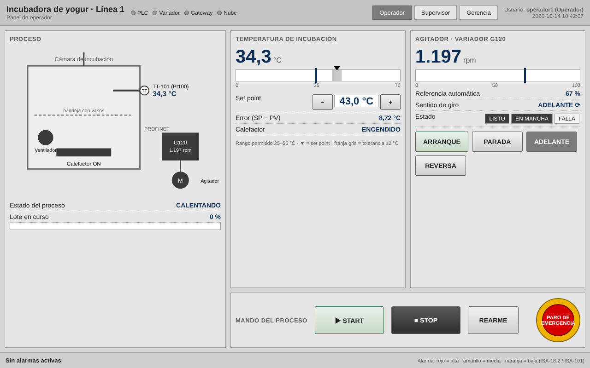
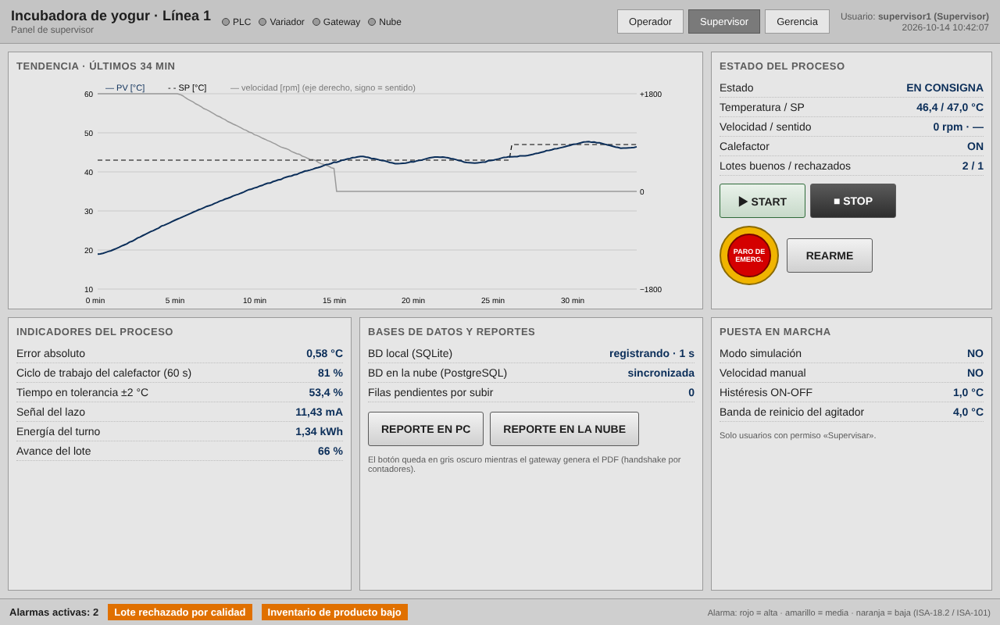
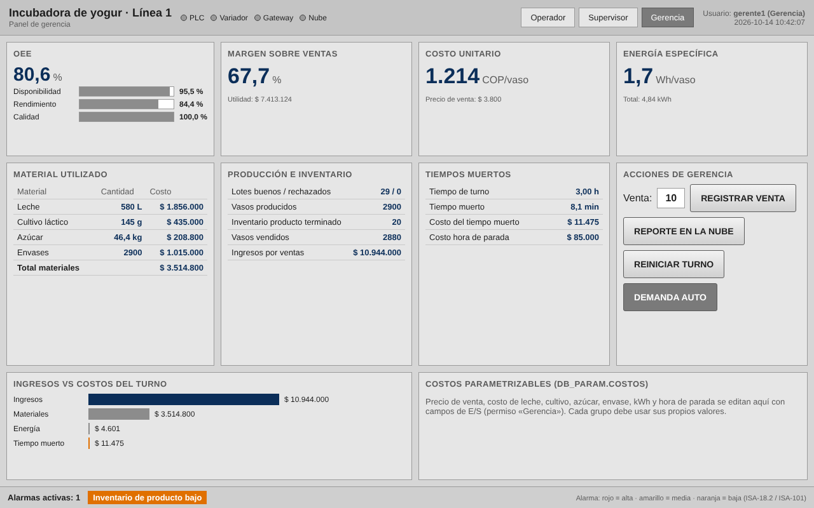

# 4. SCADA: los tres paneles en WinCC

Las maquetas (HTML en `scada/mockups/`, imágenes aquí) son la referencia de diseño. Los valores de las
maquetas salen del gemelo de la planta. Dibuje las pantallas en WinCC con estos mismos objetos y vinculaciones.

## 4.1 Configuración del HMI

1. Agregue una **estación PC** con **WinCC RT Advanced** (o WinCC Unified PC; un panel Comfort también sirve).
2. *Conexiones*: conexión integrada HMI ↔ CPU por la red PROFINET/Ethernet.
3. Las variables del HMI se crean arrastrando `DB_HMI`, `DB_Param` y `DB_Produccion` (acceso simbólico,
   DB optimizados). El gateway **no** usa WinCC: lee `DB_Gateway` por su cuenta.
4. Rango de la variable `DB_Param.Proceso.SP` en el HMI: 25..55 (el PLC también lo limita).
5. Lista de textos **"Estado"**: 0 PARADO · 1 CALENTANDO · 2 EN CONSIGNA · 3 EMERGENCIA · 4 FALLA.
6. Plantilla común (todas las pantallas): barra superior con título, estado de comunicaciones,
   botones de navegación, usuario y hora; abajo, una **línea de alarmas** (visor de avisos de una línea).

## 4.2 Norma de colores

La guía pide consultar la norma de colores para SCADA. Se aplicó **ANSI/ISA-101.01 (HMI de alto rendimiento)**
en las pantallas y **IEC 60073 / IEC 60204-1** en los botones y pilotos:

| Elemento | Color | Regla |
|---|---|---|
| Fondo de pantalla / paneles | Gris claro `#D6D6D6` / `#E6E6E6` | ISA-101: fondo neutro y de bajo contraste, sin degradados ni 3D |
| Texto y etiquetas | Gris oscuro `#1D1D1D` / `#5C5C5C` | Legible sin cansar |
| Valores de proceso | Azul oscuro `#0B2E59` | Se distinguen de las etiquetas sin usar color de alarma |
| Equipo encendido / apagado | Relleno gris oscuro `#3B3B3B` / blanco | ISA-101: el estado normal no usa rojo ni verde |
| Alarma de prioridad alta | Rojo `#D40000` | Reservado: solo se usa para alarmas |
| Alarma de prioridad media | Amarillo `#F0B400` | Reservado para alarmas |
| Alarma de prioridad baja | Naranja `#E07000` | Reservado para alarmas |
| Botón de paro de emergencia | Rojo sobre fondo amarillo | IEC 60204-1 / ISO 13850 |
| START / STOP | Verde tenue / gris oscuro (negro) | IEC 60204-1: marcha blanco/gris/negro (verde permitido), parada negro/gris (rojo permitido) |
| Pilotos físicos | Verde = marcha · amarillo = transitorio/anormal · rojo = emergencia | IEC 60073 |

Las magnitudes analógicas se muestran con **barra + valor + banda normal en gris + marcador del SP**: el
operador ve de un vistazo si está en zona normal, sin leer números.

## 4.3 Panel de operador

| Objeto | Tipo WinCC | Variable | Evento / animación |
|---|---|---|---|
| Sinóptico de la cámara | Gráficos + rectángulos | `DB_HMI.Est.Calefactor`, `.Ventilador`, `.VFD_EnMarcha` | Color de fondo: ON = `#3B3B3B`, OFF = blanco |
| Temperatura | Campo de E/S (salida) + barra | `DB_HMI.Est.PV` | Formato 99,9 °C; barra 0–70 |
| Marcador del SP y banda normal | Barra con límites | `DB_HMI.Est.SP` | Límite = SP ± 2 |
| Set point | Campo de E/S (entrada) + botones −/+ | `DB_Param.Proceso.SP` | −/+ con *Aumentar/Disminuir valor* en 0,5 |
| Error | Campo de E/S | `DB_HMI.Est.Error` | — |
| Estado del proceso | Campo de E/S simbólico | `DB_HMI.Est.Estado` | Lista de textos "Estado" |
| Avance del lote | Barra | `DB_HMI.Est.ProgresoLote_pct` | 0–100 % |
| Velocidad (rpm) | Campo de E/S + barra | `DB_HMI.Est.VFD_Vel_rpm`, `.VFD_Vel_pct` | — |
| Referencia automática | Campo de E/S | `DB_HMI.Est.VFD_VelRef_pct` | — |
| Sentido de giro | Campo simbólico + flecha | `DB_HMI.Est.VFD_Sentido` | Visibilidad de ⟳ (1) / ⟲ (−1) |
| LISTO / EN MARCHA / FALLA | Indicadores | `.VFD_Listo`, `.VFD_EnMarcha`, `.VFD_Falla` | FALLA en rojo solo si está activa |
| ARRANQUE / PARADA variador | Botones | `DB_HMI.Cmd.VFD_Arranque` / `.VFD_Parada` | *Pulsar*: **ActivarBit** (el PLC lo borra) |
| ADELANTE / REVERSA | Botones | `DB_HMI.Sel.Reversa` | *Pulsar*: ResetearBit / ActivarBit; fondo oscuro = seleccionado |
| START / STOP / REARME | Botones | `DB_HMI.Cmd.Start` / `.Stop` / `.Rearme` | *Pulsar*: ActivarBit |
| PARO DE EMERGENCIA | Botón circular rojo/amarillo | `DB_HMI.Cmd.ParoEmergencia` | *Pulsar*: ActivarBit (queda enclavado en el PLC) |

> El paro del HMI **no es un paro de emergencia certificado** (ISO 13850 exige que sea cableado). Por eso
> la planta tiene además el hongo físico, que corta la potencia del calefactor por hardware.

## 4.4 Panel de supervisor

| Objeto | Tipo WinCC | Variable | Nota |
|---|---|---|---|
| Tendencia | Visor de curvas f(t) | `Est.PV`, `Est.SP`, `Est.VFD_Vel_rpm` | Ventana de 30 min, muestreo 1 s |
| Estado del proceso | Campos de E/S | `Est.Estado`, `.PV`, `.SP`, `.VFD_Vel_rpm`, `.VFD_Sentido`, `.Calefactor` | — |
| Lotes buenos / rechazados | Campos de E/S | `DB_Produccion.Lotes_Buenos` / `.Lotes_Rechazados` | — |
| **Indicadores del proceso (≥ 2)** | Campos de E/S | `Est.Error` (abs.), `Est.DutyCalefactor_pct`, `Est.TiempoEnBanda_pct`, `Est.Senal_mA`, `DB_Produccion.Energia_kWh`, `Est.ProgresoLote_pct` | La guía pide al menos 2: hay 6 |
| BD local / nube / pendientes | Campos de E/S | `Est.GatewayOK`, `Est.NubeEstado`, `Est.PendientesNube` | Texto según lista |
| REPORTE EN PC | Botón | `DB_HMI.Cmd.ReporteLocal` | ActivarBit; fondo oscuro mientras `Est.RepLocalPend` |
| REPORTE EN LA NUBE | Botón | `DB_HMI.Cmd.ReporteNubeSup` | Fondo oscuro mientras `Est.RepNubeSupPend` |
| START / STOP / PARO / REARME | Botones | `DB_HMI.Cmd.*` | La guía los pide también aquí |
| Puesta en marcha | Campos de E/S (entrada) | `DB_Param.Sim.Activa`, `DB_Param.Variador.ModoManual`, `.VelManual_pct`, `DB_Param.Proceso.Histeresis`, `DB_Param.Variador.BandaReinicio` | Solo el permiso *Supervisar* |
| Visor de avisos | Visor de avisos | Avisos de bit (4.6) | Con acuse |

## 4.5 Panel de gerencia

| Objeto | Variable (`DB_Produccion` salvo que se indique) |
|---|---|
| OEE y componentes | `OEE_pct`, `Disponibilidad_pct`, `Rendimiento_pct`, `Calidad_pct` |
| Margen, costo unitario, energía específica | `Margen_pct`, `Utilidad`, `Costo_Unitario`, `kWh_por_Unidad` |
| Material utilizado y su costo | `Leche_L`, `Cultivo_g`, `Azucar_kg`, `Envases`, `Costo_Materiales` |
| Producción e inventario | `Lotes_Buenos`, `Lotes_Rechazados`, `Unidades`, `Inventario` |
| Ventas e ingresos | `Vendidas`, `Ingresos` |
| Tiempos muertos y su costo | `T_Turno_h`, `T_Muerto_h`, `Costo_Paradas` |
| Ingresos vs costos | Barras con `Ingresos`, `Costo_Materiales`, `Costo_Energia`, `Costo_Paradas` |
| Venta manual | Campo `DB_HMI.Sel.CantidadVenta` + botón `DB_HMI.Cmd.RegistrarVenta` |
| REPORTE EN LA NUBE | `DB_HMI.Cmd.ReporteNubeGer` (fondo oscuro mientras `Est.RepNubeGerPend`) |
| REINICIAR TURNO | `DB_HMI.Cmd.ResetTurno` (pida confirmación) |
| DEMANDA AUTO | `DB_HMI.Sel.DemandaAuto` |
| Costos parametrizables | Campos de entrada sobre `DB_Param.Costos.*` |

## 4.6 Usuarios, permisos y avisos

**Administración de usuarios** (*Runtime settings > User administration*):

| Grupo | Permisos | Usuario de prueba |
|---|---|---|
| Operadores | Operar | `operador1` |
| Supervisores | Operar, Supervisar, Reportes | `supervisor1` |
| Gerencia | Gerencia, Reportes | `gerente1` |
| Administradores | todos (incluida la administración de usuarios) | `admin` |

* Botón de navegación *Supervisor* con permiso **Supervisar**; *Gerencia* con permiso **Gerencia**.
  Si el usuario no tiene permiso, WinCC muestra el diálogo de inicio de sesión.
* Botón *Usuario* con la función **MostrarDiálogoInicioSesión**. Cierre de sesión automático a los 5 min.
* Los campos que escriben `DB_Param` exigen el permiso correspondiente (seguridad del objeto).

**Avisos de bit** (variable disparadora `DB_HMI.Est.Alarmas`, bits 0–11): un aviso por bit con el texto de la
tabla de la sección 3.4. Clases: *Errors* (con acuse) para los bits 0, 2, 4, 5 y 10; *Warnings* para 1, 3, 6 y 7;
*Información* para 8, 9 y 11. Como la variable es un Word y en el PLC se escribe con `.%Xn`, el bit n del aviso
coincide con el bit n del PLC.
