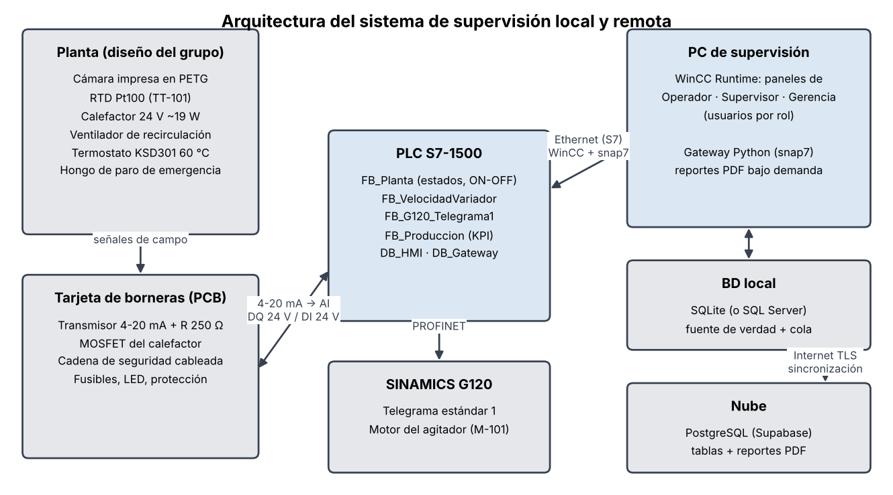
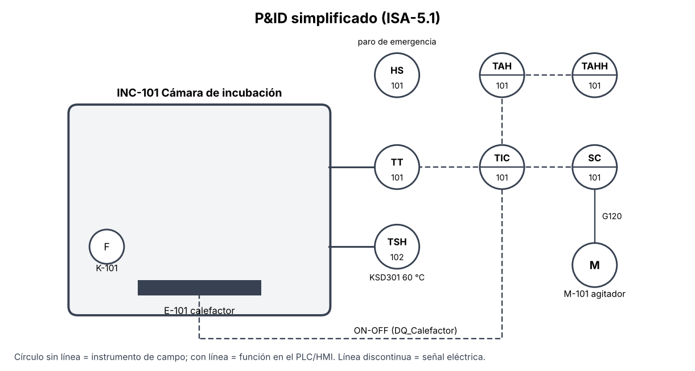

> **Nota para el grupo (borre este recuadro antes de entregar).** Este informe está completo en lo que se
> puede escribir **antes** de la práctica: proceso, diseño, programación, SCADA, bases de datos, respuesta
> esperada (simulación) y respuestas a la discusión. Las casillas **[COMPLETAR]** son **mediciones del
> laboratorio** y deben llenarse con sus datos (protocolo en `docs/08_pruebas_y_puesta_en_marcha.md`). La guía
> exige que las conclusiones sean de **su** experimentación: las de la sección 8 son un borrador basado en el
> diseño; ajústelas a lo que midan.

# Resumen

Se diseñó e implementó un sistema SCADA para una incubadora de yogur a escala de laboratorio. La planta es una
cámara impresa en PETG con un calefactor de 19 W, una RTD Pt100 acondicionada a 4-20 mA y un agitador movido
por un SINAMICS G120 por PROFINET. Un PLC S7-1500 ejecuta un control ON-OFF con histéresis de la temperatura,
una máquina de estados con seguridades y una ley de velocidad que hace girar el agitador rápido lejos de la
consigna, lo frena al acercarse y lo detiene al alcanzarla. El PLC también calcula producción, costos y KPI.
La supervisión tiene tres paneles en WinCC, uno por rol (operador, supervisor y gerencia), diseñados con
ISA-101. Un gateway en Python registra los datos en una base de datos local (SQLite) y en una base de datos en
la nube (PostgreSQL) y genera reportes PDF bajo demanda desde el HMI. Según el modelo térmico, la planta
alcanza 43 °C en unos 15 min y se mantiene en una banda de ±1 °C. Los resultados medidos se reportan en la sección 6.

**Palabras clave:** SCADA, HMI, ISA-101, control ON-OFF, PROFINET, SINAMICS G120, RTD, 4-20 mA, base de datos, OEE.

# 1. Introducción

La supervisión de procesos permite monitorear, controlar y analizar variables en tiempo real, tanto local
como remotamente. Los sistemas HMI/SCADA integran PLC, variadores y redes industriales, y llevan la información
del proceso a cada nivel de la organización: el operador necesita mandos claros, el supervisor tendencias y
reportes, y la gerencia indicadores económicos. En esta práctica una línea de producción "contrata" al grupo
para desarrollar los paneles de supervisión de su proceso, integrando el control de una variable física, el
manejo de un variador por PROFINET, bases de datos local y en la nube, y reportes bajo demanda.

# 2. Objetivos

**General.** Diseñar e implementar un sistema de supervisión local y remota para un proceso industrial, con
paneles asociados a cada rol, integrando el control de variables, la programación del PLC, la visualización
HMI/SCADA y la comunicación con plataformas externas, para una operación segura y eficiente.

**Específicos.**

1. Implementar un control ON-OFF de una variable de proceso en una planta física (temperatura) y en una emulada (nivel, Factory IO).
2. Diseñar pantallas apropiadas para cada rol del proceso (operador, supervisor y gerencia).
3. Integrar sensores y actuadores de campo, garantizando la correcta lectura y escritura de variables desde el PLC.

# 3. Marco teórico

**Supervisión local y remota.** La supervisión local se hace desde la estación de operación conectada a la red
de control (HMI/SCADA con tiempos de respuesta de cientos de milisegundos). La remota lleva los datos fuera de la
planta (nube, web) para análisis, reportes y gestión, con latencias de segundos y dependencia de Internet [1], [4].

**HMI de alto rendimiento (ISA-101).** Recomienda fondos neutros, color reservado para condiciones anormales,
magnitudes analógicas con su rango normal y jerarquía de pantallas por rol, para que el operador detecte las
desviaciones de un vistazo [5]. La gestión de alarmas sigue ISA-18.2: prioridades, retardos para evitar
alarmas molestas y acuse [6]. Los colores de botones y pilotos siguen IEC 60073 e IEC 60204-1 [7], [8].

**Control ON-OFF con histéresis.** El actuador conmuta entre dos estados cuando el error cruza ±H/2. La histéresis
evita la conmutación por ruido a costa de una oscilación permanente, que en plantas con inercia y retardo
supera el ancho de banda H. Es adecuado cuando el actuador es todo-nada y la tolerancia del proceso admite la
oscilación; un PID con salida PWM o analógica reduce la oscilación a cambio de sintonía y de un actuador modulante.

**RTD y lazo 4-20 mA.** La Pt100 varía su resistencia según Callendar–Van Dusen (100 Ω a 0 °C, 138,51 Ω a 100 °C).
Un transmisor de 2 hilos (p. ej. XTR105 [12]) excita la RTD, la linealiza y modula la corriente del lazo entre 4 y
20 mA. La corriente no se degrada con el cable, y los valores fuera de 3,6–21 mA indican falla (NAMUR NE43 [13]).

**PROFINET y PROFIdrive.** El G120 intercambia datos cíclicos con el PLC mediante telegramas. El telegrama
estándar 1 tiene dos palabras de salida (STW1, palabra de mando; NSOLL_A, consigna, 16#4000 = 100 % de p2000) y
dos de entrada (ZSW1, estado; NIST_A, velocidad real) [10], [11].

**Bases de datos y nube.** Una base de datos relacional guarda los datos en tablas consultables con SQL y garantiza
la persistencia. Plataformas como Ubidots o Node-RED son herramientas de visualización e integración, no motores
de bases de datos. Un patrón robusto es *store-and-forward*: escribir primero en local y sincronizar con la nube.

**OEE.** Eficacia global del equipo = Disponibilidad × Rendimiento × Calidad [14].

# 4. Descripción del proceso propuesto

Línea de yogur batido. La etapa supervisada es la **incubación**: la leche inoculada debe mantenerse a 42–45 °C
durante la fermentación. Mientras se calienta, un agitador homogeniza la temperatura; durante la fermentación
el producto debe quedar **en reposo**, porque agitarlo rompe el gel. Por eso el agitador gira rápido cuando la
temperatura está lejos de la consigna, frena al acercarse y se detiene al alcanzarla, tal como pide la guía.
Cada lote (5 min en la demostración, 4–6 h en la realidad) produce 100 vasos de 200 mL. Un lote que pasa más de
60 s fuera de ±2 °C durante la fermentación se rechaza.

# 5. Diseño e implementación

## 5.1 Planta y hardware

* **Cerramiento** de diseño propio, impreso en PETG (160 × 120 × 120 mm interior), con bandeja para los vasos,
  manguito para la RTD, soporte del ventilador, prensaestopas y alojamiento del termostato. No se usa PLA porque
  se ablanda cerca de la temperatura de trabajo.
* **Calefactor:** 2 resistencias RH25 de 15 Ω en serie sobre una placa de aluminio (19,2 W, 0,8 A a 24 V de la
  fuente del banco), conmutadas con un MOSFET IRLZ44N desde `DQ_Calefactor`.
* **Medición:** Pt100 del laboratorio → transmisor 4-20 mA → R de carga de 250 Ω → 1–5 V en la entrada analógica.
  Así se respeta el máximo de 10 V de las entradas: aunque el transmisor sature, el zener de 6,2 V limita.
* **Seguridad cableada:** hongo de paro (contacto NC en serie con la potencia y otro a una DI) y termostato KSD301
  de 60 °C en serie. El calefactor no puede encenderse con el paro accionado ni con sobretemperatura, aunque el PLC falle.
* **Tarjeta impresa de borneras** con fusibles, protección y LED indicador.

## 5.2 Programa del PLC

Lenguaje: SCL (fuentes externas importables). Bloques: `FC_EscalarRTD` (4-20 mA → °C y falla NE43),
`FB_OnOffHist` (ON-OFF genérico, también usado en el nivel emulado), `FB_VelocidadVariador`, `FB_G120_Telegrama1`,
`FB_Produccion` (lotes, materiales, ventas, tiempos muertos, KPI), `FB_SimPlanta` y `FB_SimVariador` (gemelo para
PLCSIM) y `FB_Planta` (máquina de estados, alarmas e interfaz con el HMI y el gateway).

**Ley de velocidad.** Con e = SP − PV, Vmax = 100 %, Vmin = 20 %, Emax = 15 °C y Tc = 0,5 °C:

| Condición | Referencia de velocidad v |
|---|---|
| \|e\| ≥ Emax | v = Vmax |
| Tc < \|e\| < Emax | v = Vmin + (Vmax − Vmin) · \|e\| / Emax |
| \|e\| ≤ Tc | v = 0 y queda enclavado |
| enclavado y \|e\| > 4 °C (banda de reinicio) | se libera y vuelve a girar según las filas anteriores |

Gracias al enclavamiento el agitador no arranca y para en cada ciclo del ON-OFF. El sentido lo elige el
operador y se aplica con el signo de NSOLL_A.

**Seguridades:** paro de emergencia (HMI enclavado + hongo físico), falla del sensor, temperatura ≥ 60 °C y
cadena de seguridad abierta llevan a estados seguros (calefactor OFF, variador OFF1) que se salen con Rearme.
Hay 12 alarmas con prioridades y retardos de 10 s en las de desviación (ISA-18.2).

## 5.3 Paneles SCADA

Tres pantallas en WinCC con usuarios por rol. Cumplen lo pedido en la guía:

| Requisito de la guía | Implementación |
|---|---|
| Operador: SP, arranque/parada/sentido del variador, indicadores de la variable y del variador, start/stop/paro, animaciones | Barra con banda normal y marcador de SP, campo de SP con ±, sinóptico animado, rpm, referencia, sentido, estados del variador, botones IEC 60204-1 |
| Supervisor: monitoreo, estado del proceso, reporte en el PC, BD local y en la nube con PV, velocidad y sentido, ≥ 2 indicadores, reporte en la nube, start/stop/paro | Tendencia PV/SP/rpm, 6 indicadores (error, ciclo de trabajo, % en tolerancia, señal mA, energía, avance del lote), estado de las BD, botones de reporte con handshake |
| Gerencia: material y costo, inventario, ventas, ingresos, tiempos muertos y costo, ≥ 3 KPI, reporte en la nube | Tablas de materiales, producción, ventas y tiempos muertos; OEE (D, R, C), margen, costo unitario, energía específica; botón de reporte |
| Norma de colores | ISA-101 en pantallas, IEC 60073 en pilotos, IEC 60204-1 en botones |

## 5.4 Bases de datos y reportes

El gateway lee el `DB_Gateway` (no optimizado, 166 bytes) por S7/snap7 cada segundo, guarda las filas en SQLite y
las sincroniza por lotes con PostgreSQL en la nube (Supabase). Si se cae Internet, acumula las filas y las sube al
volver. Las tablas son `proceso`, `gerencia`, `eventos` y `reportes`. Los reportes se piden desde el HMI con un
handshake por contadores (el PLC incrementa la solicitud, el gateway devuelve el acuse). El reporte local es un PDF en
el PC; los de la nube se generan con los datos consultados a la nube y se guardan en la tabla `reportes`.

## 5.5 Proceso emulado (Factory IO)

ON-OFF de nivel con la escena *Level control* y el mismo `FB_OnOffHist` (banda ±2 %, descarga fija del 30 % como perturbación).

# 6. Resultados

## 6.1 Respuesta esperada (diseño)

Modelo térmico de 2 nodos (placa: 80 J/K y 0,5 K/W; cámara: 450 J/K y 2,4 K/W; vaina de la RTD: τ = 15 s),
simulado con la misma lógica del PLC:

| Métrica (modelo) | Valor esperado |
|---|---|
| Tiempo hasta SP − 0,5 °C | 15,1 min |
| Tiempo hasta EN CONSIGNA | 15,7 min |
| Sobrepico sobre 43 °C | 0,95 °C |
| Oscilación en régimen (pico a pico) | 1,87 °C |
| Período del ciclo ON-OFF | ≈ 300 s |
| Ciclo de trabajo del calefactor | 51 % |

## 6.2 Resultados medidos [COMPLETAR]

| Prueba | Resultado medido |
|---|---|
| Calibración del lazo (100 / 119,4 / 138,5 Ω) | [COMPLETAR mA y °C] |
| Arranque en frío: tiempo hasta SP − 0,5 °C / sobrepico | [COMPLETAR] |
| Régimen: oscilación p-p / período / ciclo de trabajo | [COMPLETAR] |
| Velocidad vs. error (5 puntos) | [COMPLETAR tabla] |
| Tapa abierta 2 min: caída / reacción del agitador / lote | [COMPLETAR] |
| Seguridades (hongo, sensor abierto, termostato, falla del variador) | [COMPLETAR: OK / observaciones] |
| Reportes: PC / nube supervisor / nube gerencia (tiempo de generación) | [COMPLETAR] |
| Corte de Internet: filas pendientes y recuperación | [COMPLETAR] |
| Nivel en Factory IO: oscilación y conmutaciones por minuto | [COMPLETAR] |

[COMPLETAR: inserte aquí las capturas de la tendencia real, de los tres paneles en runtime, de la tabla en Supabase
y los PDF de los reportes.]

# 7. Análisis de resultados

La guía pide comparar el diseño inicial con la solución implementada en funcionalidad, desempeño y alcance.
Use esta estructura y llene las cifras:

**Funcionalidad.** Todas las funciones pedidas quedaron implementadas en el diseño (tabla de 5.3). [COMPLETAR:
indique las que cambiaron al implementar, p. ej. si el rango del canal analógico fue 0–10 V en vez de 1–5 V, si se
usó un transmisor comercial en vez del XTR105, o si alguna pantalla se simplificó.]

**Desempeño del control.** El modelo predice un sobrepico de ~1 °C y una oscilación de ~1,9 °C p-p con H = 1 °C:
la oscilación casi duplica la histéresis por la energía que la placa sigue entregando después del apagado y por el
retardo de la vaina de la RTD. [COMPLETAR: compare con lo medido. Si la oscilación real es mayor, la inercia de la
placa es mayor que la supuesta: identifique K, τ y θ con la prueba escalón (sección 2.2 de la documentación),
actualice el modelo y explique la diferencia. Discuta si ±1 °C es aceptable para el yogur (sí, la ventana es de
42 a 45 °C) y qué pasaría con H = 0,5 °C y con H = 2 °C.]

**Agitador.** La banda de reinicio de 4 °C evitó que el agitador siguiera el ciclo del ON-OFF. Su valor es un
compromiso: debe ser mayor que la oscilación en régimen y menor que la perturbación que sí debe reactivar la
agitación. En la simulación, abrir la tapa 2 min a 48 °C bajó la temperatura ~4 °C, justo en el límite.
[COMPLETAR con lo observado.]

**Alcance.** [COMPLETAR: qué quedó por fuera (p. ej. PID, validación del modelo, más perturbaciones), las
limitaciones del laboratorio (red, fuente, tiempo) y lo que se haría en una versión industrial: paro de
emergencia de categoría certificada, redundancia de la medición, servidor histórico.]

**Integración con el negocio.** El KPI de calidad vincula el control con la economía: en la simulación, un cambio
de SP de 43 a 47 °C en plena fermentación dejó el proceso fuera de tolerancia más de 60 s y se rechazó el lote,
lo que bajó la calidad y subió el costo unitario. [COMPLETAR con los KPI de su turno real.]

# 8. Conclusiones (borrador: valídelas con sus datos)

1. El control ON-OFF con histéresis de 1 °C mantuvo la temperatura de incubación dentro de [COMPLETAR] °C,
   suficiente para la ventana de 42–45 °C del yogur. La inercia térmica de la placa calefactora hace que la
   oscilación real supere el ancho de la histéresis, así que H se debe elegir con la dinámica de la planta, no solo con el ruido.
2. Enclavar el agitador al llegar a la consigna, con una banda de reinicio mayor que la oscilación del ON-OFF,
   cumple la consigna de velocidad de la guía y tiene sentido de proceso: agitar al calentar, reposo al fermentar.
3. Separar la seguridad cableada (hongo y termostato en serie con la potencia) de la lógica del PLC hizo que las
   pruebas de falla llevaran siempre la planta a un estado seguro [COMPLETAR: resultado de S3–S5].
4. Diseñar las pantallas por rol con ISA-101 reduce la información de cada panel a lo que ese rol decide; el uso
   del color solo para alarmas hizo evidente [COMPLETAR: observación de la práctica].
5. Escribir primero en la base local y sincronizar con la nube toleró el corte de Internet sin perder datos
   [COMPLETAR: S15]; la nube aporta acceso remoto y reportes, pero no debe estar en el lazo de control.

# 9. Preguntas para la discusión

**a) ¿Cuál es la diferencia entre supervisión local y supervisión remota, y qué ventajas ofrece cada una?**
La local se hace desde una estación conectada directamente a la red de control (WinCC en el PC del banco). Tiene
latencia baja y determinista, funciona sin Internet, permite mandos en tiempo real y es la adecuada para operar,
reconocer alarmas y actuar ante emergencias. La remota lleva los datos fuera de la planta (aquí, PostgreSQL en la
nube): da acceso desde cualquier lugar, historiales centralizados de varias plantas, reportes para gerencia y
analítica, sin instalar software en cada sitio. Sus costos son la latencia variable, la dependencia de Internet y
una superficie de ataque mayor. Por eso se usa para monitorear y analizar, no para mandar en tiempo real.

**b) ¿Por qué es importante integrar HMI y SCADA con el PLC?**
El PLC tiene la lógica determinista y las seguridades; el HMI/SCADA le da al humano visibilidad y mando. Integrarlos
con variables simbólicas compartidas (aquí `DB_HMI`) garantiza que lo que se ve es el estado real del proceso,
permite cambiar consignas y parámetros sin reprogramar, centraliza alarmas y eventos con su contexto, y alimenta el
registro histórico y los reportes. Sin esa integración los datos se duplican y aparecen inconsistencias. Además, el
PLC sigue operando y protegiendo el proceso aunque el SCADA falle.

**c) ¿Qué criterios deben considerarse para elegir entre ON-OFF y PID?**
(1) El actuador: si es todo-nada (relé, válvula solenoide) el ON-OFF es natural; un PID requiere actuador modulante o
PWM. (2) La tolerancia del proceso: si admite la oscilación (aquí ±1 °C en una ventana de 3 °C), el ON-OFF basta; si
exige error casi nulo, PID. (3) La dinámica: plantas lentas, con gran inercia y retardo, oscilan más con ON-OFF.
(4) El desgaste: cada conmutación desgasta relés y contactores; el ON-OFF necesita histéresis para limitarlas.
(5) El costo y la complejidad: el ON-OFF no requiere sintonía ni modelo; el PID sí, y además manejo de anti-windup.
(6) La eficiencia energética y la calidad del producto cuando la oscilación influye en ellas.

**d) ¿Cómo influyen las alarmas y seguridades (nivel alto, nivel bajo, paro de emergencia) en la confiabilidad?**
Las alarmas de alto y bajo avisan antes de que la desviación afecte al producto o al equipo y dan tiempo de
reaccionar. Bien diseñadas (prioridades, retardos y acuse según ISA-18.2) evitan la avalancha de alarmas que hace
ignorar las importantes. Las seguridades (HH que apaga el calefactor, falla del sensor, paro de emergencia) llevan
el proceso a un estado seguro definido sin depender del operador. Para que sean confiables deben ser independientes
de la función de control: aquí el hongo y el termostato cortan la potencia por hardware, porque un paro
implementado solo en software (como el botón del HMI) no es un paro de emergencia válido según ISO 13850. Todo esto
reduce los daños y las paradas no planificadas, y mejora la disponibilidad (OEE).

**e) ¿Qué papel cumple la visualización gráfica y numérica en la toma de decisiones del operador?**
La gráfica (barras con banda normal, tendencias, animaciones de estado) permite detectar patrones y desviaciones de
un vistazo: si la temperatura está subiendo o bajando y si el ciclo del ON-OFF cambió. La numérica da el valor
exacto para ajustes finos y registros. Combinadas con ISA-101 (fondo neutro, color solo para anomalías) reducen la
carga cognitiva y el tiempo de reacción; mostrar el SP sobre la barra de la PV hace evidente el error sin calcularlo.

**f) ¿Cómo se relaciona el funcionamiento del variador con el comportamiento de la variable análoga?**
En esta práctica la consigna de velocidad es función del error de temperatura: v = Vmin + (Vmax − Vmin)·|e|/Emax,
saturada en Vmax y enclavada en 0 al llegar al SP. El variador recibe la consigna por PROFINET (NSOLL_A) y la sigue
con sus rampas (p1120/p1121), así que la velocidad real (NIST_A) sigue la temperatura con el retardo de la rampa. En la
industria esta relación es común: ventiladores o bombas cuya velocidad sigue una variable de proceso (temperatura,
presión, nivel), lo que ahorra energía frente a la marcha a velocidad fija.

**g) ¿Qué ventajas y limitaciones tiene la supervisión en la nube frente a la local y remota tradicional?**
Ventajas: acceso desde cualquier dispositivo, sin servidores propios; escalabilidad y respaldo gestionado;
centralización de varias plantas; integración con analítica, reportes y aprendizaje automático; bajo costo inicial
(plan gratuito de Supabase). Limitaciones: depende de Internet (aquí se mitiga con almacenamiento local y
sincronización posterior); latencia variable, inadecuada para control; riesgos de ciberseguridad (credenciales,
exposición a Internet: deben seguirse NIST SP 800-82 [4] y la segmentación de redes); costos recurrentes y
dependencia del proveedor; y requisitos legales sobre dónde se guardan los datos.

**h) ¿Cómo contribuye esta práctica a las competencias en diseño, implementación y análisis de sistemas de automatización?**
Integra todo el ciclo: formular un proceso con requisitos de negocio, diseñar la planta y su instrumentación con
seguridad cableada, programar el PLC de forma estructurada, comunicarse con un accionamiento por un perfil estándar
(PROFIdrive), diseñar HMI con normas (ISA-101, ISA-18.2, IEC 60073), manejar bases de datos y la nube, y traducir
el comportamiento técnico en indicadores económicos (OEE, costo unitario). El análisis "diseño vs implementación"
con un modelo simulado es la práctica real de la puesta en marcha industrial (FAT/SAT).

# 10. Bibliografía

[1] S. A. Boyer, *SCADA: Supervisory Control and Data Acquisition*, 3rd ed. Research Triangle Park, NC, USA: ISA, 2004.

[2] E. J. M. Colbert and A. Kott, Eds., *Cyber-security of SCADA and Other Industrial Control Systems*. Cham, Switzerland: Springer, 2016.

[3] A. S. AlMadhoun, *PLC SCADA for Beginners: Understanding and Implementing Industrial Automation Systems*. Berkeley, CA, USA: Apress, 2025.

[4] K. Stouffer *et al.*, "Guide to Operational Technology (OT) Security," NIST SP 800-82 Rev. 3, National Institute of Standards and Technology, 2023.

[5] *Human Machine Interfaces for Process Automation Systems*, ANSI/ISA-101.01-2015, ISA, 2015.

[6] *Management of Alarm Systems for the Process Industries*, ANSI/ISA-18.2-2016, ISA, 2016.

[7] *Basic and safety principles for man-machine interface, marking and identification – Coding principles for indicators and actuators*, IEC 60073:2002.

[8] *Safety of machinery – Electrical equipment of machines – Part 1: General requirements*, IEC 60204-1:2016.

[9] *Safety of machinery – Emergency stop function – Principles for design*, ISO 13850:2015.

[10] Siemens AG, *SINAMICS G120 Control Units CU240B-2/CU240E-2 – Operating Instructions*, 2020.

[11] PROFIBUS & PROFINET International, *PROFIdrive – Profile Drive Technology*, v4.2, 2015.

[12] Texas Instruments, "XTR105 4-20 mA Current Transmitter with Sensor Excitation and Linearization," SBOS061, datasheet.

[13] NAMUR, *NE 43: Standardization of the Signal Level for the Failure Information of Digital Transmitters*, 2003.

[14] S. Nakajima, *Introduction to TPM: Total Productive Maintenance*. Cambridge, MA, USA: Productivity Press, 1988.

# Anexos

* A. Fuentes del PLC: `plc/fuentes_scl/` (SCL) y tabla de variables `plc/tablas/Variables_PLC.xlsx`.
* B. Gateway y bases de datos: `gateway/` (Python, pruebas automáticas, configuración).
* C. Carcasa: `hardware/carcasa/` (OpenSCAD y STL). Esquemáticos: `hardware/pcb/`.
* D. Maquetas de los paneles: `scada/mockups/`. Protocolo de pruebas: `docs/08_pruebas_y_puesta_en_marcha.md`.
